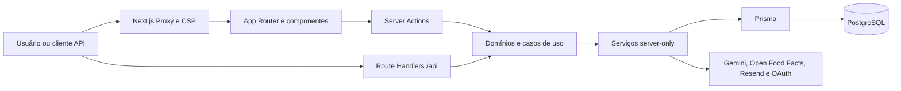
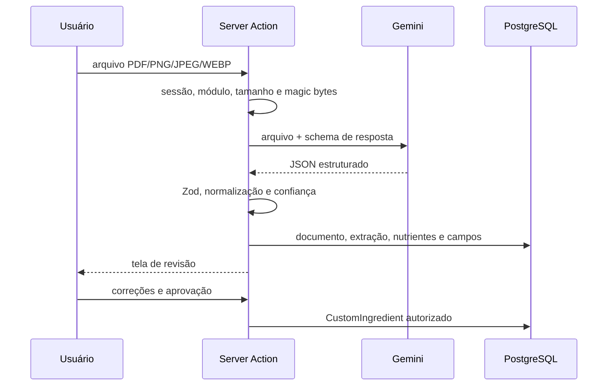
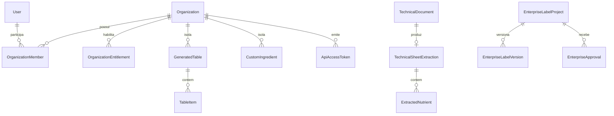

# Arquitetura e funcionamento completo do SoIZI

Atualizado em: 25/08/2026.

Status: documento canônico da arquitetura implementada no checkout
`Projeto-Rotulagem-security-regras-negocio/calculadora-nutricional`, branch
`security/regras-negocio-backend`.

## 1. Objetivo e contrato deste documento

Este documento descreve o sistema como ele funciona hoje no código: produto,
arquitetura, stack, árvore do repositório, responsabilidades, fluxos, banco de
dados, segurança, integrações, testes, deploy, decisões e limitações conhecidas.

Quatro classificações evitam confundir intenção com realidade:

| Classificação | Significado |
| --- | --- |
| **Implementado** | Existe no runtime atual e há código que executa o comportamento. |
| **Preparado** | Há modelo, configuração ou estrutura, mas o fluxo não está completo ou exposto. |
| **Histórico** | Aparece em migrations ou documentos antigos, mas não integra o runtime atual. |
| **Recomendação** | Melhoria arquitetural proposta; não deve ser tratada como entregue. |

O código e o `prisma/schema.prisma` são a fonte de verdade do comportamento da
aplicação. A pasta `prisma/migrations` é a fonte de verdade da evolução histórica
do banco. Quando ambos divergem, a divergência é documentada, não ocultada.

## 2. Resumo executivo

O SoIZI é uma aplicação web multiusuário e multi-organização para construir,
calcular, revisar, versionar e exportar informações de rotulagem nutricional.
Seus núcleos são:

- receitas, ingredientes e tabelas nutricionais;
- cálculo nutricional e declaração de porção;
- rotulagem nutricional frontal, chamada de lupa/FOP;
- exportações técnicas em imagem, planilha e documentos;
- importação assistida de fichas técnicas com Gemini e revisão humana;
- projetos Enterprise com versões, aprovações, mercados e exportações;
- controle de acesso por organização, função, perfil, módulo e token de API;
- integrações com Open Food Facts, provedores OAuth, Resend e Gemini.

A arquitetura segue uma aplicação monolítica modular em Next.js. Interface,
Server Actions, Route Handlers, domínios puros, serviços de infraestrutura e
persistência vivem no mesmo deploy, mas obedecem fronteiras de importação e de
autoridade. Não há microsserviços, fila, worker separado ou RLS no PostgreSQL.

A decisão de segurança mais importante é esta: o navegador pode produzir uma
prévia, mas não é autoridade para persistência, documentos oficiais ou cálculos
sensíveis. Nessas fronteiras o servidor revalida identidade, organização,
módulo, entrada e regras de negócio, e recalcula os dados necessários.

## 3. Contexto do produto

### 3.1 Usuários e casos de uso

O produto atende profissionais e equipes que precisam:

- cadastrar ou reaproveitar ingredientes;
- descrever uma receita e seu rendimento;
- montar uma tabela nutricional;
- revisar porções, medidas caseiras, arredondamentos e nutrientes;
- calcular a incidência e as dimensões da lupa frontal;
- salvar e editar o trabalho sem perder o estado da interface;
- exportar materiais técnicos;
- transformar ficha técnica em ingrediente após revisão humana;
- trabalhar com versões e aprovações em um contexto Enterprise;
- consultar dados autorizados por uma API externa versionada.

O sistema auxilia o trabalho técnico, mas não substitui a responsabilidade do
profissional que conhece o produto, sua formulação e seu enquadramento legal.

### 3.2 Capacidades ativas

| Área | Situação atual |
| --- | --- |
| Autenticação por credencial e OAuth | Implementado |
| Recuperação de senha e 2FA TOTP | Implementado |
| Organizações, membros, perfis e módulos | Implementado |
| Ingredientes próprios e base de alimentos | Implementado |
| Open Food Facts | Implementado |
| Tabelas nutricionais e lupa frontal | Implementado |
| Excel, memorial e imagens editáveis | Implementado |
| Importação de ficha técnica por IA | Implementado, com revisão humana |
| Projetos, versões e aprovações Enterprise | Implementado |
| Tokens e API externa `/api/v1` | Implementado |
| Convites de organização | Preparado no modelo; sem fluxo completo atual |
| Billing/Stripe | Histórico/configuração reservada; não implementado no runtime atual |
| Marketing analytics | Histórico/configuração reservada; não implementado no runtime atual |

## 4. Visão arquitetural

### 4.1 Estilo

O sistema é um **monólito modular full-stack**. Essa escolha permite compartilhar
tipos e regras puras, realizar renderização no servidor e manter as mutações
próximas do domínio, sem pagar a complexidade operacional de serviços separados.
As fronteiras são lógicas e verificadas por scripts de arquitetura.



### 4.2 Camadas e responsabilidades

| Camada | Local principal | Responsabilidade |
| --- | --- | --- |
| Apresentação | `src/app`, `src/components` | Rotas, layouts, formulários, feedback e composição visual. |
| Feature | `src/features/*` | Agrupar ações, componentes, domínio, páginas internas e serviços por capacidade. |
| Domínio | `src/features/*/domain` | Regras determinísticas e tipos sem acesso ao banco. |
| Casos de uso HTTP | Server Actions e `src/app/api` | Autenticar, autorizar, validar DTOs, executar a operação e devolver resposta segura. |
| Infraestrutura | `src/lib`, `src/features/*/services` | Prisma, criptografia, e-mail, APIs externas, rate limit e telemetria. |
| Persistência | `prisma` | Modelo relacional, constraints, índices, migrations e seed. |
| Guardrails | `scripts`, CI | Verificar fronteiras, validações, segurança, tipos, testes e build. |

### 4.3 Fronteiras de confiança

1. **Internet → aplicação:** cookies, headers, corpo, arquivos e bearer tokens são
   não confiáveis.
2. **Navegador → servidor:** IDs, nutrientes calculados, `organizationId`, função
   e permissões enviados pelo cliente nunca concedem autoridade.
3. **Aplicação → banco:** o Prisma restringe a forma usual de acesso, mas o
   isolamento de tenant depende dos filtros da aplicação; não existe RLS.
4. **Aplicação → provedores:** respostas de Gemini e Open Food Facts são dados
   externos e passam por normalização/validação.
5. **Prévia → artefato oficial:** a prévia do navegador é conveniência; o servidor
   recompõe o estado autoritativo para persistência e exportações oficiais.

## 5. Stack e versões observadas

As versões abaixo vêm do `package.json`, `package-lock.json` e ambiente local
observado em 25/08/2026. Onde a declaração usa `^`, a versão instalada é a que
representa este checkout.

| Tecnologia | Versão observada | Uso |
| --- | --- | --- |
| Node.js | 24.18.0 no ambiente local | Runtime local/CI. O projeto ainda não declara `engines`. |
| npm | 11.16.0 no ambiente local | Instalação e scripts. |
| Next.js | 16.2.12 | App Router, Server Components, Server Actions, Route Handlers e build. |
| React / React DOM | 19.2.3 | Interface declarativa e componentes cliente/servidor. |
| TypeScript | 5.9.3 instalado | Tipagem estrita e contratos internos. |
| Prisma / Prisma Client | 5.22.0 | ORM, schema e migrations PostgreSQL. |
| PostgreSQL | 16 no Compose local | Persistência relacional e rate limit atômico. |
| NextAuth | 4.24.15 | Credentials, OAuth, JWT e callbacks de sessão. |
| Tailwind CSS | 4.1.18 | Tokens, utilitários e estilos. |
| Radix UI / shadcn | Radix 1.6.2 e primitives | Componentes acessíveis e design system local. |
| Zod | 4.4.3 | Validação de payloads e respostas externas. |
| bcryptjs | 3.0.3 | Hash de senha. |
| Google GenAI | 2.2.0 | Extração estruturada de fichas técnicas. |
| ExcelJS | 4.4.0 | Geração e leitura de planilhas usadas pelo produto. |
| html-to-image | 1.11.13 | Exportações visuais no navegador. |
| lucide-react | 0.562.0 | Ícones. |
| sonner | 2.0.7 | Toasts e feedback. |
| input-otp | 1.4.2 | Entrada acessível de códigos 2FA. |
| qrcode | 1.5.4 | QR Code de provisionamento TOTP. |

Observações:

- o lockfile usa `lockfileVersion: 3`;
- `xlsx` não é dependência direta do runtime atual; menções em documentos antigos
  devem ser entendidas como históricas;
- `jszip` aparece de forma transitiva, não como contrato direto da aplicação;
- `next-themes` está instalado, mas o tema efetivo é controlado pelo provider
  próprio e pelas variáveis CSS do projeto;
- o CI usa Node 24; declarar `engines` é uma recomendação de alinhamento.

## 6. Modelo de execução do Next.js

### 6.1 Server Components e Client Components

Páginas e layouts são Server Components por padrão. Componentes recebem
`"use client"` apenas quando precisam de estado local, eventos, APIs do browser,
contextos de interface ou efeitos. Isso reduz JavaScript no cliente e mantém
leitura de sessão e dados sensíveis no servidor.

### 6.2 Server Actions

Mutações iniciadas pela interface são, em geral, Server Actions em
`src/features/<feature>/actions`. Elas devem:

1. declarar `"use server"`;
2. obter a sessão/contexto no servidor;
3. validar a organização e o módulo necessários;
4. converter `FormData` em um DTO explícito;
5. validar o DTO;
6. consultar ou gravar sempre no escopo da organização;
7. registrar evento/auditoria quando aplicável;
8. revalidar a rota ou devolver resultado serializável.

### 6.3 Route Handlers

Integrações HTTP, arquivos, auth e API externa usam Route Handlers. Operações
mutáveis rejeitam requisições cross-origin e aplicam limites antes de executar
trabalho custoso. Respostas não expõem erros internos, hashes ou stack traces.

### 6.4 Serviços `server-only`

Código que acessa Prisma, chaves, tokens ou integrações usa `import "server-only"`.
O verificador arquitetural impede que componentes cliente importem Prisma ou
serviços de infraestrutura e impede que o domínio puro conheça o ORM.

## 7. Árvore comentada do repositório

```text
Projeto-Rotulagem-security-regras-negocio/       # raiz Git deste checkout
├── .github/
│   ├── dependabot.yml                          # atualização de dependências
│   └── workflows/security.yml                  # pipeline de qualidade/segurança
└── calculadora-nutricional/                    # aplicação e documentação
    ├── Dataset/                                # fontes e referências alimentares
    ├── docs/
    │   ├── architecture/                       # decisões e organização temática
    │   ├── database/sql/                       # SQL legado/manual documentado
    │   ├── operations/                         # deploy, banco, exportações e rollout
    │   ├── references/                         # materiais técnicos de referência
    │   ├── reports/                            # relatórios locais, não canônicos
    │   └── system/                             # esta visão integral
    ├── prisma/
    │   ├── migrations/                         # 20 diretórios de evolução
    │   ├── schema.prisma                       # 26 modelos e 11 enums atuais
    │   └── seed.ts                             # carga inicial
    ├── public/                                 # logos, bandeiras e imagens FOP
    ├── scripts/                                # checks, banco e utilitários
    ├── src/
    │   ├── app/                                # App Router e Route Handlers
    │   ├── components/                         # componentes compartilhados/UI
    │   ├── features/                           # módulos funcionais coesos
    │   ├── hooks/                              # hooks compartilhados do cliente
    │   ├── lib/                                # auth, Prisma, segurança e validação
    │   └── proxy.ts                            # dashboard e CSP por requisição
    ├── .env.example                            # contrato de configuração
    ├── components.json                         # shadcn, aliases e ícones
    ├── docker-compose.local.yml                 # PostgreSQL 16 local
    ├── next.config.ts                          # headers, imagens e limites
    ├── package.json / package-lock.json         # dependências, versões e scripts
    ├── tsconfig.json                           # strict e resolução bundler
    └── vercel.json                             # install e build no deploy
```

### 7.1 Módulos em `src/features`

```text
features/
├── api-access/          # criação, listagem e revogação de tokens
├── auth/                # cadastro e componentes de autenticação
├── enterprise/          # projetos, versões, aprovações e exportações
├── i18n/                # catálogo e troca de idioma da interface
├── ingredients/         # ingredientes, cadastro, consultas e formulários
├── master/              # autoridade interna global
├── open-food-facts/     # busca, normalização, importação e cache
├── organizations/       # tipos e regras de organização
├── profile/             # perfil do usuário
├── saas/                # contexto, módulos e autorização multi-tenant
├── settings/            # identidade, 2FA, membros, perfis e módulos
├── tables/              # cálculo, persistência, FOP e exportação
└── technical-sheets/    # upload, IA, revisão e criação de ingrediente
```

Cada feature pode conter `actions`, `components`, `domain`, `pages` e `services`.
A existência de uma pasta não autoriza dependências arbitrárias: domínio continua
puro, infraestrutura continua server-only e a interface não fala diretamente com
o banco.

## 8. Mapa de páginas

### 8.1 Páginas públicas

| Rota | Função |
| --- | --- |
| `/` | Página pública inicial. |
| `/login` | Login por credencial, OAuth e etapa de 2FA. |
| `/register` | Cadastro com aceite legal versionado. |
| `/forgot-password` | Solicitação de recuperação sem revelar existência da conta. |
| `/reset-password` | Definição de nova senha por token. |
| `/termos-de-uso` | Termos e versão legal vigente. |
| `/politica-de-privacidade` | Política de privacidade. |

### 8.2 Dashboard

| Rota | Função principal |
| --- | --- |
| `/dashboard` | Visão inicial do workspace. |
| `/dashboard/tables` | Listagem de tabelas salvas. |
| `/dashboard/new` | Construção de uma tabela. |
| `/dashboard/edit/[id]` | Edição de tabela existente e tenant-scoped. |
| `/dashboard/edit/[id]/lupa` | Configuração e prévia da rotulagem frontal. |
| `/dashboard/ingredients` | Entrada da área de ingredientes. |
| `/dashboard/ingredients/my-ingredients` | Ingredientes próprios da organização. |
| `/dashboard/ingredients/technical-sheets` | Importação e revisão de fichas por IA. |
| `/dashboard/enterprise` | Projetos e workflow Enterprise. |
| `/dashboard/api-access` | Administração de tokens da API. |
| `/dashboard/profile` | Dados pessoais e senha. |
| `/dashboard/settings` | Organização, segurança, membros, perfis e módulos. |

As rotas antigas `/dashboard/master/modules`, `/dashboard/master/plans` e
`/dashboard/modules` são compatibilidades que redirecionam para `/dashboard`.
Elas não significam que há telas atuais de planos ou billing.

## 9. Mapa das APIs

| Método e rota | Responsabilidade | Controle principal |
| --- | --- | --- |
| `GET/POST /api/auth/[...nextauth]` | NextAuth, providers e callbacks | Configuração NextAuth |
| `POST /api/auth/forgot-password` | Criar token e enviar e-mail | Same-origin, rate limit, resposta genérica |
| `POST /api/auth/reset-password` | Validar token e trocar senha | Hash, expiração, uso único e rate limit |
| `GET /api/health` | Liveness da aplicação | Não consulta dependências críticas |
| `GET /api/ready` | Readiness com banco | Consulta controlada ao PostgreSQL |
| `GET /api/open-food-facts` | Buscar produto/alimento externo | Validação e limite de requisição |
| `POST /api/open-food-facts` | Importar/cachear alimento | Sessão, módulo, same-origin e tenant |
| `POST /api/export/complete` | Gerar exportação oficial completa | Sessão, módulo, DTO e recálculo servidor |
| `POST /api/export/excel` | Gerar planilha | Sessão, módulo e estado autoritativo |
| `GET /api/export/memorial` | Gerar memorial | Sessão, módulo e tabela tenant-scoped |
| `GET/POST /api/participant-modules` | Ler/alterar grants de membro | Administração e organização |
| `POST /api/workspace/select` | Selecionar organização ativa | Membership, rate limit e cookie seguro |
| `DELETE /api/tables/[id]` | Excluir tabela da organização | Sessão, módulo, same-origin e tenant |
| `GET /api/v1/tables` | Consultar tabelas via integração | Bearer token, organização e módulo |

`/api/v1` é o início do contrato externo versionado. As demais rotas são
contratos internos do frontend e podem evoluir junto com o aplicativo.

## 10. Fluxos de ponta a ponta

### 10.1 Cadastro e criação do workspace

1. O usuário envia nome, e-mail, senha e aceite legal.
2. O servidor normaliza e valida os campos.
3. A senha passa pela política de força e é gravada com bcrypt, custo 12.
4. Usuário, organização inicial, membership de proprietário e módulos padrão são
   provisionados de forma coerente.
5. A versão dos termos/política aceita fica registrada.
6. O usuário passa a autenticar pelo NextAuth.

No primeiro login OAuth, callbacks equivalentes provisionam usuário e workspace
quando necessário. Providers só são habilitados quando suas variáveis existem.

### 10.2 Login e 2FA

1. O login por credencial aplica uma camada rápida de limite em memória e um
   limite persistente no PostgreSQL.
2. E-mail e senha são validados; falhas devolvem erro genérico.
3. Se 2FA estiver habilitado, um código TOTP de seis dígitos e janela de 30
   segundos é exigido.
4. O secret TOTP permanece cifrado com AES-256-GCM.
5. O NextAuth emite sessão JWT; o proxy valida a sessão para o dashboard.

### 10.3 Seleção de organização e autorização

1. O servidor lê a sessão e o cookie HttpOnly `soizi-active-organization`.
2. Confirma que a membership e a organização estão ativas.
3. Se a seleção estiver obsoleta, escolhe um workspace válido sem produzir
   efeitos colaterais durante a leitura.
4. A troca valida a membership antes de atualizar o cookie `SameSite=Lax`,
   `Secure` em produção.
5. A operação seguinte verifica entitlement, perfil/função e grant aplicáveis.

A precedência de módulos é:

1. o módulo precisa estar habilitado para a organização;
2. uma permissão explícita do perfil prevalece nos módulos controlados por perfil;
3. se um módulo controlado não tiver permissão no perfil, o acesso é negado;
4. proprietário e administrador acessam módulos não restringidos pelo perfil;
5. membro comum depende do grant explícito quando aplicável.

A autoridade interna global é derivada exclusivamente da allowlist server-side
`INTERNAL_MASTER_EMAILS`. Ela não é concedida por parâmetro, perfil ou módulo.

### 10.4 Criação e salvamento de tabela

1. A interface seleciona ingredientes, quantidades, rendimento e configurações.
2. Funções puras calculam uma prévia imediata no navegador.
3. Ao salvar, a Server Action valida usuário, organização, módulo, IDs e DTO.
4. Ingredientes são lidos no escopo permitido e os valores são recalculados.
5. A tabela e seus itens são gravados com `organizationId` e autoria.
6. Valores por 100 g relevantes são copiados para `TableItem`, formando snapshot
   e evitando alteração retroativa quando o ingrediente de origem mudar.
7. O estado evolutivo da tela é persistido em `GeneratedTable.uiState` JSON.

### 10.5 Lupa frontal e exportações

1. A tela calcula uma prévia com as mesmas regras puras compartilhadas.
2. O servidor carrega a tabela pelo par `id + organizationId`.
3. Referências de preparação são resolvidas apenas entre IDs/snapshots permitidos.
4. Receita, nutrientes, overrides, declaração e lupa são recompostos.
5. O payload final é validado antes de gerar Excel ou memorial.
6. Alterações sensíveis de lupa podem gerar registro de auditoria.

PNG/SVG gerados no browser são úteis para edição e composição visual, mas não
possuem assinatura de autenticidade. Documentos oficiais server-side são a
fronteira autoritativa do sistema.

### 10.6 Importação de ficha técnica por IA



O modelo padrão é `gemini-2.5-flash`, configurável por ambiente. A temperatura é
baixa, a resposta usa schema estruturado e o retorno ainda é validado por Zod.
Erros transitórios têm tentativas limitadas com backoff. Arquivos pequenos podem
usar fallback inline; lotes são processados sequencialmente, sem fila externa.

Confiança abaixo de 0,6 é sinalizada para revisão; uma extração sem nutrientes
úteis ou com confiança crítica não vira ingrediente automaticamente. A IA sugere;
a aprovação humana cria o ingrediente.

### 10.7 Enterprise

O fluxo Enterprise organiza um projeto de rótulo em estados intermediários,
versões imutáveis por snapshot, aprovações e exportações. Mercados previstos pelo
domínio incluem Brasil, Estados Unidos, União Europeia, Canadá, México e Chile.

Estados colaborativos podem ser atualizados por usuários habilitados. A aprovação
final exige a permissão de `SETTINGS`. O modelo atual não implementa segregação
formal de função por departamento nem a regra de “quatro olhos”.

### 10.8 API externa

1. Um administrador cria um token com prefixo `soizi_`.
2. O segredo completo aparece uma única vez.
3. O banco guarda apenas SHA-256, prefixo, últimos quatro caracteres, expiração e
   metadados.
4. O cliente envia `Authorization: Bearer <token>` para `/api/v1/tables`.
5. O servidor valida token ativo, organização, membership e módulo.
6. `lastUsedAt` é atualizado no máximo aproximadamente uma vez por minuto,
   evitando escrita em toda leitura.

## 11. Domínio de cálculo nutricional

### 11.1 Regras puras

`src/features/tables/domain/nutrients.ts` concentra operações como:

- escala de nutrientes por 100 g conforme quantidade utilizada;
- soma da receita;
- transformação do produto preparado;
- fatores energéticos;
- micronutrientes manuais;
- identificação de açúcares adicionados conforme o modelo da entrada.

`portion-declarations.ts` e arquivos regulatórios relacionados concentram porção,
medida caseira, fração, rendimento, categoria e forma de declaração. A lupa tem
domínio próprio em `fop-lupa.ts`, inclusive dimensionamento tipográfico.

### 11.2 Por que as funções são compartilhadas

As funções determinísticas podem ser executadas na interface para resposta rápida
e no servidor para autoridade. Compartilhar regra reduz divergência; executar de
novo no servidor impede que payload manipulado substitua a regra.

### 11.3 Estado relacional e estado evolutivo

- identidade, ownership, ingredientes e itens essenciais são relacionais;
- nutrientes dos itens formam snapshots históricos;
- `uiState` JSON preserva opções de interface que evoluem mais rápido que o
  schema relacional;
- snapshots Enterprise preservam versões completas sem depender do estado atual.

Essa combinação favorece consistência no núcleo e compatibilidade na periferia.
O trade-off é exigir validação/migração do JSON quando seu contrato evoluir.

## 12. Arquitetura de dados

### 12.1 Conexão

O Prisma usa:

- `POSTGRES_PRISMA_URL` para a conexão normal, compatível com pool;
- `POSTGRES_URL_NON_POOLING` como `directUrl` para migrations/operações diretas.

`src/lib/prisma.ts` mantém uma instância singleton em desenvolvimento para evitar
clientes duplicados durante hot reload.

### 12.2 Catálogo dos 26 modelos atuais

#### Identidade, tenant e segurança

| Modelo | Papel |
| --- | --- |
| `User` | Identidade, credencial, aceite legal, 2FA e autoria. |
| `Organization` | Tenant e identidade organizacional. |
| `OrganizationMember` | Relação usuário-organização, função, status e perfil. |
| `OrganizationInvitation` | Convite persistível; fluxo ainda preparado. |
| `OrganizationProfile` | Perfil de acesso específico de uma organização. |
| `GlobalOrganizationProfile` | Template global de perfil. |
| `GlobalOrganizationProfilePermission` | Permissões do template global. |
| `OrganizationProfilePermission` | Permissões do perfil local. |
| `OrganizationEntitlement` | Módulos habilitados para a organização. |
| `ParticipantModuleGrant` | Concessão explícita de módulo a participante. |
| `ApiAccessToken` | Hash e metadados de tokens externos. |
| `SecurityAuditLog` | Eventos de segurança e administração. |
| `RateLimitBucket` | Contadores persistentes de limite por janela. |

#### Nutrição

| Modelo | Papel |
| --- | --- |
| `Ingredient` | Base/importação compartilhada de ingrediente. |
| `CustomIngredient` | Ingrediente criado e controlado pelo tenant. |
| `GeneratedTable` | Tabela nutricional, estado e metadados. |
| `TableItem` | Ingrediente da receita e snapshot nutricional. |

#### Fichas técnicas e IA

| Modelo | Papel |
| --- | --- |
| `TechnicalDocument` | Arquivo e metadados do documento submetido. |
| `TechnicalSheetExtraction` | Execução, status, conteúdo estruturado e confiança. |
| `ExtractedNutrient` | Nutriente extraído. |
| `ExtractedAllergen` | Alérgeno extraído. |
| `ExtractedTechnicalField` | Campo técnico extraído por categoria. |

#### Enterprise

| Modelo | Papel |
| --- | --- |
| `EnterpriseLabelProject` | Projeto e estado colaborativo. |
| `EnterpriseLabelVersion` | Snapshot versionado do rótulo. |
| `EnterpriseApproval` | Decisão e autoria de aprovação. |
| `EnterpriseExport` | Registro do artefato exportado. |

### 12.3 Enums

Os 11 enums atuais são `DocumentType`, `ExtractionStatus`, `ReviewStatus`,
`TechnicalFieldCategory`, `EnterpriseApprovalStatus`, `EnterpriseExportType`,
`OrganizationStatus`, `OrganizationRole`, `OrganizationKind`,
`OrganizationInvitationStatus` e `SaaSModuleKey`.

### 12.4 Relações de alto nível



Todas as consultas de entidades pertencentes ao cliente devem combinar o
identificador do recurso com `organizationId`. `userId` representa autoria; não
substitui a fronteira do tenant.

### 12.5 Migrations e divergência histórica

Há 20 diretórios de migration. A migration histórica
`20260515120000_add_saas_billing_modules_marketing` criou estruturas de plano,
billing, webhook e marketing, além de valores de enum associados. Esses modelos
não existem no `schema.prisma` atual e não há migration posterior explícita que
remova todos os objetos históricos.

Consequências:

- billing e marketing **não são funcionalidades ativas da aplicação**;
- bancos que receberam toda a história podem conservar tabelas não gerenciadas
  pelo Prisma Client atual;
- variáveis Stripe/marketing do `.env.example` são reservas históricas;
- é necessária decisão futura: reintroduzir formalmente os modelos ou criar
  migration aditiva de reconciliação após backup e inventário do banco real.

Não se deve executar `prisma db push` em produção para “corrigir” essa diferença.
Produção exige backup, migration revisada e `prisma migrate deploy`.

## 13. Autenticação e segurança

### 13.1 Autenticação

- Credentials com e-mail e senha;
- Google, Facebook/Meta e Azure AD habilitados somente com configuração completa;
- sessão JWT via NextAuth;
- proteção de `/dashboard` no proxy;
- segredo de autenticação com tamanho mínimo verificado em produção;
- recuperação com token aleatório, hash SHA-256, expiração de uma hora, uso único
  e resposta anti-enumeração;
- alteração de e-mail exige novo login.

### 13.2 Política de senha

Senhas têm comprimento aceito de 10 a 256 caracteres e são rejeitadas quando
comuns ou quando incorporam informações óbvias como nome/e-mail. O hash usa
bcrypt com fator de custo 12. O limite máximo também protege o hashing contra
entradas abusivamente grandes.

### 13.3 2FA TOTP

O TOTP usa seis dígitos e período de 30 segundos. O secret é cifrado com
AES-256-GCM, incluindo versão, IV, tag e ciphertext em Base64URL. A chave deriva
de `TWO_FACTOR_ENCRYPTION_KEY` ou, como fallback, de `NEXTAUTH_SECRET` por
SHA-256. O banco não armazena o secret em claro.

### 13.4 CPF/CNPJ

CPF e CNPJ são normalizados e validados pelos dígitos verificadores. Para reduzir
exposição, o sistema guarda HMAC-SHA-256, últimos quatro dígitos e tipo necessário
ao domínio. A chave usa `DOCUMENT_HASH_SECRET`, com fallback controlado para
`NEXTAUTH_SECRET`. A variável dedicada ainda precisa entrar explicitamente no
`.env.example`; isso é dívida documental/configuracional.

### 13.5 Autorização e isolamento multi-tenant

Autenticação não implica autorização. Cada operação sensível valida usuário,
organização, membership, entitlement, função/perfil/grant e ownership pelo
`organizationId`. IDs do formulário localizam recursos, mas nunca escolhem o
tenant; o tenant nasce do contexto de sessão verificado.

O banco não usa Row-Level Security. Uma consulta sem `organizationId` é falha de
segurança da aplicação, mesmo que esteja tipada e use Prisma.

### 13.6 Same-origin, CSP e headers

Route Handlers mutáveis chamam `rejectCrossOriginRequest`, comparando `Origin`
com `APP_URL`, `NEXTAUTH_URL` ou o host do deploy. O proxy gera nonce por
requisição e aplica CSP com `strict-dynamic`, bloqueio de objetos e ancestors.

Headers adicionais incluem `nosniff`, proteção de frame, política de referrer e
permissões, COOP/CORP e desativação de prefetch DNS. Estilos inline continuam
permitidos pelo contrato visual; `unsafe-eval` é restrito ao desenvolvimento.

### 13.7 Rate limit

O limite persistente usa `RateLimitBucket` no PostgreSQL. A chave é hash SHA-256
com salt e a atualização utiliza UPSERT atômico. O contador negado é limitado a
`max + 1`, evitando crescimento sob ataque, e há limpeza de janelas expiradas.

Login também mantém camada rápida em memória. Ela reduz custo local, mas não é
suficiente em múltiplas instâncias; o bucket persistente é a camada coordenada.

### 13.8 Uploads e corpos

- limites globais/específicos são configuráveis;
- no Vercel, Server Actions são limitadas efetivamente a 4 MB;
- tipo declarado e magic bytes são verificados;
- ficha aceita PDF, PNG, JPEG e WEBP;
- validação ocorre antes da chamada custosa à IA.

O menor limite da cadeia sempre prevalece.

### 13.9 Logs e auditoria

`SecurityAuditLog` registra ações administrativas e sensíveis, como mudanças de
configuração, tokens, módulos e lupa. Eventos operacionais usam logs JSON
estruturados. Segredos, hashes, cookies e conteúdo de documentos não devem ir ao
log.

### 13.10 Guardrails automatizados

`scripts/security-check.mjs` rejeita, entre outros:

- rotas de debug proibidas;
- `$queryRawUnsafe` e `$executeRawUnsafe`;
- `dangerouslySetInnerHTML`, `eval` e `new Function`;
- Prisma ou serviços server-only importados pelo cliente;
- Prisma importado por domínios puros;
- actions sem `"use server"`;
- serviços de infraestrutura sem `server-only`;
- Route Handlers mutáveis sem rejeição cross-origin.

`scripts/check-validation-boundaries.mjs` evita cópias locais de regex/contratos
que devem viver em `src/lib/validation`. Os scripts transformam decisões de
arquitetura em falhas objetivas de CI.

## 14. Frontend e design system

### 14.1 Componentes, tema e tokens

Primitives em `src/components/ui` seguem shadcn/Radix, estilo `new-york`, TSX,
Server Components e ícones Lucide. Componentes de feature compõem as primitives
sem criar um segundo design system concorrente.

Light/dark usam variáveis semânticas em `src/app/globals.css` e provider local.
Escala da interface e tema são preferências armazenadas no navegador. Superfícies,
bordas, foco, estado destrutivo e elevação usam tokens semânticos.

### 14.2 Formulários obrigatórios

Campos obrigatórios usam o atributo HTML `required`; o rótulo recebe asterisco
visual pelo contrato CSS compartilhado. Depois de interação/tentativa inválida,
o controle usa `:user-invalid` e borda/anel destrutivo. Não é necessário repetir
a palavra “obrigatório” em cada label.

O asterisco é comunicação visual, não validação. HTML, DTO/Zod, domínio e banco
continuam responsáveis por validar a entrada em suas fronteiras.

### 14.3 Internacionalização

A fonte textual é pt-BR. `i18n` aplica catálogo no cliente e persiste a escolha em
`localStorage`. Idiomas expostos incluem pt-BR, en-US, es-MX e fr-CA; um valor
antigo `es-CL` é migrado para es-MX.

Como a tradução é aplicada após hidratação, isso não equivale a rotas
internacionalizadas no servidor e pode produzir transição visual. Mensagens
tipadas server-side são uma evolução possível.

### 14.4 Estado

- estado efêmero de formulário permanece em React;
- sessão e tenant são server-backed;
- preferências visuais não sensíveis usam `localStorage`;
- organização ativa usa cookie HttpOnly;
- tabelas persistem núcleo relacional e `uiState` validado;
- o servidor não confia em estado derivado apenas no cliente.

## 15. Integrações externas

### 15.1 Gemini

Uso: extração estruturada de ficha técnica. Controles: chave server-side, schema
de resposta, Zod, baixa temperatura, limites de arquivo, retry limitado e revisão
humana.

### 15.2 Open Food Facts

Uso: busca por texto/código de barras e importação. O serviço normaliza campos,
restringe hosts de imagem, envia User-Agent adequado e pode cachear o resultado
como `Ingredient` com origem registrada. Dados externos não recebem confiança
implícita.

### 15.3 Resend e OAuth

Resend envia recuperação de senha server-side. Google, Facebook/Meta e
Microsoft/Azure AD são opcionais e só aparecem quando ID e secret correspondentes
estão presentes. Redirect URIs pertencem ao ambiente, não ao browser.

### 15.4 Serviços não existentes hoje

Não há no runtime atual cobrança Stripe, webhook de billing, marketing analytics,
object storage próprio, broker/fila/worker ou serviço OCR local separado.

## 16. Configuração por ambiente

| Grupo | Exemplos | Quando é necessário |
| --- | --- | --- |
| Banco | `POSTGRES_PRISMA_URL`, `POSTGRES_URL_NON_POOLING` | Desenvolvimento, migrations e runtime. |
| Auth | `NEXTAUTH_SECRET`, `NEXTAUTH_URL`, `APP_URL` | Runtime; segredo forte em produção. |
| Criptografia | `TWO_FACTOR_ENCRYPTION_KEY`, `DOCUMENT_HASH_SECRET` | Chaves dedicadas recomendadas em produção. |
| Hash operacional | salt de rate limit/analytics | Pseudonimizar chaves de controle. |
| Master | `INTERNAL_MASTER_EMAILS` | Somente para função interna global. |
| E-mail | chave/remetente Resend | Recuperação por e-mail. |
| OAuth | IDs e secrets por provider | Apenas para provider habilitado. |
| IA | chave Gemini, modelo e limites | Importação de ficha técnica. |
| Requisições | limites de corpo/arquivo/rate | Ajuste operacional. |
| Stripe/marketing | placeholders históricos | Sem consumidor ativo atual. |

Segredos nunca devem usar prefixo `NEXT_PUBLIC_`. Valores de CI são fictícios e
servem para build/checks sem conectar a banco real.

## 17. Desenvolvimento local, build e deploy

### 17.1 Banco local

`docker-compose.local.yml` sobe PostgreSQL 16 Alpine em `127.0.0.1:54329`, com
volume nomeado e healthcheck. A porta distinta reduz conflito com instalação
local padrão.

```bash
npm run db:local:up
npm run db:local:migrate
npm run dev
```

`predev` prepara o banco local conforme os scripts. Antes de apontar para outro
ambiente, conferir as variáveis efetivas; banco local e remoto não são
intercambiáveis.

### 17.2 Scripts principais

| Script | Função |
| --- | --- |
| `npm run dev` | Next dev com Webpack. |
| `npm run build` | Gera Prisma Client e faz build Next.js. |
| `npm run lint` | ESLint. |
| `npm run typecheck` | TypeScript sem emissão. |
| `npm test` | Testes unitários. |
| `npm run check` | Lint, tipos, fronteiras, testes e `prisma validate`. |
| `npm run security:check` | Guardrails e auditoria npm em severidade moderada. |
| `npm run db:local:up/migrate/down` | Ciclo do PostgreSQL local. |

`db:push` é conveniência de desenvolvimento. Não é processo de release de banco
em produção.

### 17.3 Vercel e publicação

`vercel.json` usa `npm ci` e build Prisma + Next. O runtime depende das variáveis
do projeto e do PostgreSQL externo. O limite de Server Actions cai para 4 MB.

Uma publicação completa separa:

1. backup compatível do banco;
2. migrations com conexão direta;
3. build/deploy;
4. smoke de health/readiness, login e fluxo crítico;
5. observação de logs sem payloads sensíveis.

## 18. Qualidade, testes e CI

O repositório possui 18 arquivos `.test.ts`, cobrindo principalmente regras puras,
validações, módulos e segurança. O conjunto atual executa 56 testes.

O workflow `../.github/workflows/security.yml`, na raiz Git, usa Node 24 e executa:

1. `npm ci --ignore-scripts`;
2. geração do Prisma Client;
3. security check;
4. lint;
5. typecheck;
6. testes;
7. `prisma validate`;
8. build.

O CI usa URLs/secrets fictícios e não valida banco remoto. Não há suíte E2E no
`npm check`. A verificação runtime de módulos é opcional, cria dados de teste e
exige banco/servidor local; não deve ser executada em ambientes compartilhados.

Dependabot verifica npm semanalmente e agrupa patch/minor. Mudanças major exigem
decisão e validação deliberadas.

## 19. Exemplos representativos do código

Os trechos são simplificados. Os arquivos indicados são a fonte exata.

### 19.1 Action protegida por tenant e módulo

```ts
"use server";

const context = await getCurrentSaaSContext();
await requireModuleAccess(context, "TABLES");

const input = tableInputSchema.parse(rawInput);
const table = await prisma.generatedTable.findFirst({
  where: { id: input.id, organizationId: context.organization.id },
});
```

O ponto central não é apenas validar `id`; é combinar recurso e tenant derivado
da sessão.

### 19.2 Domínio puro reutilizável

Padrão de `src/features/tables/domain/nutrients.ts`:

```ts
export function scaleNutrient(per100g: number, quantityInGrams: number) {
  return (per100g * quantityInGrams) / 100;
}
```

Funções assim não importam Prisma, cookies ou React. Podem ser testadas
isoladamente e reutilizadas na prévia e no recálculo autoritativo.

### 19.3 Serviço restrito ao servidor

```ts
import "server-only";
import { prisma } from "@/lib/prisma";

export async function loadOrganizationTable(id: string, organizationId: string) {
  return prisma.generatedTable.findFirst({ where: { id, organizationId } });
}
```

### 19.4 Token mostrado uma vez

```ts
const secret = randomBytes(32).toString("base64url");
const rawToken = `soizi_${secret}`;
const tokenHash = createHash("sha256").update(rawToken).digest("hex");

await prisma.apiAccessToken.create({ data: { tokenHash, prefix, lastFour } });
return { token: rawToken }; // única apresentação do segredo completo
```

Uma leitura posterior lista prefixo/últimos dígitos, mas não reconstrói o token.

### 19.5 Rejeição cross-origin

```ts
export async function POST(request: Request) {
  const crossOriginResponse = rejectCrossOriginRequest(request);
  if (crossOriginResponse) return crossOriginResponse;
  // autenticação, rate limit, validação e caso de uso
}
```

### 19.6 Validação em duas fronteiras

```tsx
<input name="email" type="email" required />
```

```ts
const input = emailSchema.parse(await request.json());
```

O primeiro melhora a experiência; o segundo protege o servidor.

## 20. Decisões arquiteturais e trade-offs

| Decisão | Motivo | Custo/risco assumido |
| --- | --- | --- |
| Monólito modular | Deploy simples e compartilhamento de tipos/regras. | Fronteiras dependem de disciplina e checks. |
| App Router + Server Actions | Dados/mutações próximos da página. | Serialização e limite de corpo. |
| Domínios puros | Testabilidade e uso cliente/servidor. | Adaptadores montam entradas completas. |
| Recálculo no servidor | Impede prévia manipulada como dado oficial. | Trabalho duplicado e consistência entre caminhos. |
| Prisma + PostgreSQL | Modelo relacional, migrations e transações. | Sem RLS, filtro tenant depende da aplicação. |
| JWT no NextAuth | Sessão sem consulta em todo request. | Casos de uso revalidam acesso atual. |
| Snapshot em itens/versões | Preserva histórico técnico. | Duplica dados e exige evolução cuidadosa. |
| JSON em `uiState` | Evolução rápida da tela. | Menor garantia relacional; requer schema. |
| IA com revisão humana | Automatiza sem delegar decisão ao modelo. | Etapa operacional e estados intermediários. |
| Rate limit no PostgreSQL | Coordena instâncias sem serviço adicional. | Escrita/contenção sob escala. |
| Tokens com hash | Banco vazado não revela bearer token. | Token perdido precisa ser recriado. |
| HMAC de CPF/CNPJ | Comparação com menor exposição. | Rotação da chave exige estratégia. |

## 21. Limitações e dívidas conhecidas

### Prioridade alta

- reconciliar schema e objetos históricos de billing/marketing por migration
  segura, após inventário e backup do banco real;
- manter auditoria de consultas tenant-scoped, pois não há RLS;
- definir `DOCUMENT_HASH_SECRET` no `.env.example` e no runbook;
- avaliar registros Enterprise anteriores ao recálculo autoritativo.

### Prioridade média

- declarar Node suportado em `engines` e alinhar local/CI/deploy;
- implementar ou remover formalmente convites de organização;
- adicionar E2E para login, workspace, criação/exportação e API;
- aumentar integração com banco real isolado;
- decidir storage durável se retenção do arquivo original for requisito;
- definir segregação formal no Enterprise se aprovação exigir independência;
- documentar rotação de chaves TOTP/HMAC e tokens operacionais.

### Evoluções de escala

- mover lotes de IA para fila/worker se volume e duração crescerem;
- considerar rate limit dedicado se PostgreSQL virar gargalo;
- ampliar versionamento, paginação e escopos da API;
- migrar i18n para renderização tipada no servidor;
- assinar artefatos visuais se autenticidade de PNG/SVG for necessária.

## 22. Regras para evoluir o sistema

### 22.1 Nova entidade tenant-scoped

1. adicionar `organizationId`, relação, índice e constraint;
2. criar migration aditiva;
3. derivar tenant da sessão, nunca do formulário;
4. filtrar leituras/mutações por tenant;
5. testar tentativa cross-tenant;
6. avaliar auditoria e exclusão;
7. atualizar documentação e API.

### 22.2 Nova mutação

1. Server Action com `"use server"` ou Route Handler;
2. same-origin para HTTP mutável;
3. sessão, workspace e módulo;
4. DTO e limites explícitos;
5. regra autoritativa no servidor;
6. resposta sem detalhes internos;
7. revalidação, auditoria e testes.

### 22.3 Nova integração

1. segredo server-side e variável documentada;
2. timeout, limite, retry e indisponibilidade;
3. schema da resposta externa;
4. minimização de dados enviados;
5. log sem conteúdo sensível;
6. fallback/estado honesto na interface;
7. teste com adapter/mock, sem produção no CI.

### 22.4 Nova migration

1. confirmar banco e branch;
2. privilegiar mudança aditiva;
3. revisar volume, backfill e locks;
4. fazer backup antes do remoto;
5. aplicar localmente e validar Prisma;
6. usar `prisma migrate deploy` na entrega;
7. nunca substituir migration de produção por `db push`.

## 23. Observabilidade e operação

`/api/health` responde sobre o processo; `/api/ready` verifica a dependência de
banco. Isso distingue processo vivo de instância pronta para tráfego.

Logs estruturados devem correlacionar tipo, operação, resultado e identificadores
não sensíveis. O checkout não descreve plataforma completa de tracing, métricas
ou SLO; isso é capacidade operacional externa, não presumida.

Em incidentes, preservar horário/ambiente, commit implantado, organização/recurso
por ID não secreto, classe/status do erro, dependência afetada e evento em
`SecurityAuditLog` quando aplicável.

## 24. Glossário

| Termo | Definição no sistema |
| --- | --- |
| Tenant/workspace | Organização ativa que delimita dados e acesso. |
| Membership | Relação ativa entre usuário e organização. |
| Entitlement | Módulo habilitado para a organização. |
| Grant | Concessão explícita de módulo a participante. |
| Perfil | Conjunto de permissões aplicado a membership. |
| FOP/lupa | Rotulagem nutricional frontal e suas regras visuais. |
| Snapshot | Cópia histórica independente da origem mutável. |
| DTO | Objeto explícito de entrada/saída de uma fronteira. |
| Server Action | Mutação da UI executada no servidor Next.js. |
| Route Handler | Endpoint HTTP dentro do App Router. |
| Autoritativo | Resultado validado/recalculado no servidor. |
| Internal master | Operador global derivado de allowlist server-side. |

## 25. Fontes internas e leituras complementares

Fontes primárias:

- `src/app` — páginas e APIs;
- `src/features` — capacidades, domínio e casos de uso;
- `src/lib` e `src/features/*/services` — auth e infraestrutura;
- `prisma/schema.prisma` — modelo atual;
- `prisma/migrations` — história do banco;
- `scripts/security-check.mjs` — invariantes arquiteturais e de segurança;
- `../.github/workflows/security.yml` — pipeline obrigatório da raiz Git;
- `.env.example`, `next.config.ts`, `src/proxy.ts` — contrato operacional.

Leituras complementares:

- `docs/security-business-rules-audit-2026-08-24.md` — fronteiras de autoridade;
- `docs/operations/DEPLOY.md` — publicação;
- `docs/operations/LOCAL_DATABASE.md` — PostgreSQL local;
- `docs/operations/EXPORTACOES.md` — formatos e validação;
- `docs/operations/IMPORTADOR_FICHAS_TECNICAS_IA.md` — operação da IA;
- `docs/operations/ROLLOUT-ORGANIZACOES-CPF-CNPJ.md` — rollout e backup.

Em conflito com textos arquiteturais antigos, este documento prevalece para o
estado de 25/08/2026. Documentos regulatórios específicos continuam sendo a
referência do próprio assunto e não são substituídos por esta visão geral.
